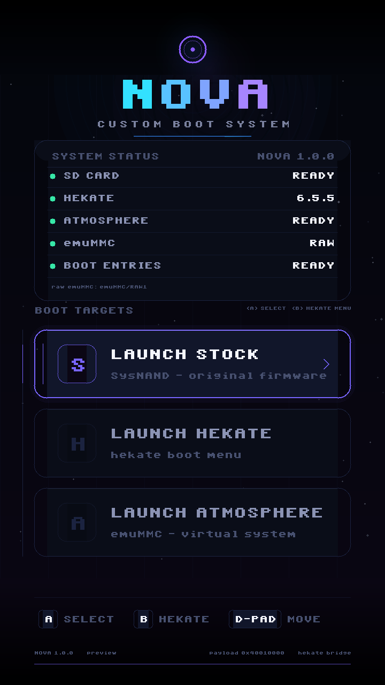

# NOVA — custom boot system for Nintendo Switch

NOVA is a pre-boot interface for the Nintendo Switch. It runs **before Horizon OS**
as a genuine Tegra X1 payload, inspects the SD card, and hands the chosen boot
target to [hekate](https://github.com/CTCaer/hekate), the supported HOS
bootloader. Everything is SD based and reversible: NOVA never writes BOOT0,
BOOT1, the NAND or any Nintendo/Atmosphère/emuMMC file.

This repository has two branches, each containing one application:

| Branch | Application | Output |
| --- | --- | --- |
| `Nova-boot` (default) | NOVA Boot, the boot interface | `NOVA.bin` — ARM32 Tegra payload |
| `Nova-installer` | NOVA Installer, the homebrew manager | `Nova-Installer.nro` |

Both share the file layout and version contract in
[`include/nova_shared.h`](include/nova_shared.h).



## What NOVA Boot does

1. Initialises the Tegra display controller, SDMMC controller and input.
2. Draws the NOVA menu on the internal panel (720×1280, works handheld and
   docked through the console's own scaling).
3. Inspects the SD card and validates each boot target:
   * `atmosphere/package3` for Atmosphère;
   * `emummc/emummc.ini` plus its `raw_based`/`file_based` marker, the
     `Nintendo` folder and `bootloader/sys/emummc.kipm` for emuMMC;
   * a real hekate payload (magic and size validated), not just a file name.
4. Offers the boot targets:

   | Option | Shown when | What NOVA does |
   | --- | --- | --- |
   | `LAUNCH STOCK` | hekate + `atmosphere/package3` present | chainloads hekate with boot id `nvstk` (OFW, `stock=1`) |
   | `LAUNCH HEKATE` | a valid hekate payload exists | chainloads hekate with no boot id (hekate menu) |
   | `LAUNCH ATMOSPHERE` | emuMMC fully valid **and** Atmosphère + hekate present | chainloads hekate with boot id `nvemu` (`emummcforce=1`) |

   The emuMMC entry is **hidden** when any of its requirements fails; the status
   panel explains why.

The selection is passed through hekate's documented *Payload storage*
(`boot_cfg` at payload offset `0x94`, "boot from ID"). NOVA therefore never edits
`bootloader/hekate_ipl.ini`. It only ever creates its own
`bootloader/ini/NOVA.ini`, which hekate scans automatically when booting by ID.

On every start NOVA writes `Nova/state/boot.txt` with a boot counter. The
installer uses it to prove that a configured automatic boot actually reached
NOVA; without that marker the installer reports "awaiting cold boot", never
success.

## Automatic cold boot

Modchip and dongle loaders (Spacecraft-NX/HWFLY-NX, Picofly, SD-payload-capable
RCM dongles) boot `/payload.bin` from the SD root **instead of BOOT0**. NOVA is a
genuine ARM32 payload inside their 128 KB limit, so it can occupy that slot:

| Console | Cold boot of NOVA | Requirement |
| --- | --- | --- |
| Unpatched Erista | yes | a dongle/modchip loader that reads `payload.bin` from SD |
| Patched Erista | yes | a modchip (fusee-gelee is patched out) |
| Mariko (V2/Lite/OLED) | yes | a modchip (sdloader reads `payload.bin`) |
| Any console, no injector | no | BOOT0/AutoRCM is intentionally not used |

NOVA Installer writes and verifies this file, backs up the previous payload and
restores it on request. Automatic boot is never claimed as working until the
NOVA boot marker advances after a reboot. See the installer branch for the
`AUTOMATIC BOOT` screen and the full hardware matrix.

NOVA itself never enables AutoRCM or touches BOOT0/BOOT1; AutoRCM corrupts the
boot configuration and is excluded by design.

## Build

```bash
# host unit tests for the detection/boot-config core
make host-test

# the payload (needs devkitARM and a hekate checkout)
make -C payload HEKATE=/path/to/hekate
```

`make -C payload verify` validates that the result really is an ARM32 Tegra
payload linked at `0x40010000` inside the IRAM budget. See
[`docs/BUILD.md`](docs/BUILD.md) for the toolchain setup (devkitPro) and CI.

Latest build in this branch: `dist/NOVA.bin` (86,224 bytes, NOVA 1.1.0).

## Verification status

| Item | Status |
| --- | --- |
| Detection, INI parsing, hekate boot-id patching | **unit tested on host** (78 checks) |
| `NOVA.bin` cross compilation | **compiled** with devkitA64/devkitARM 15.2.0 |
| Payload format (ELF/ARM32/entry/size/relocations) | **verified** by `tools/verify_payload.py` |
| UI layout and rendering | **rendered on host** from the shipping drawing code |
| Boot marker write on console | **not tested on hardware** |
| Automatic cold boot through a modchip/dongle | **not tested on hardware** |
| Real console boot (display, SD, Joy-Con, chainload) | **not tested on hardware** |

NOVA Boot has not been executed on a Nintendo Switch in this project yet. It is
built on hekate's own proven BDK drivers and mirrors hekate's payload
bring-up, but that is not the same as hardware validation — see
[`docs/TESTING.md`](docs/TESTING.md).

## Safety

* No NAND, BOOT0/BOOT1 or eMMC access of any kind; NOVA only mounts the SD card.
* hekate performs the actual HOS boot, exactly as it does normally.
* Any failure (missing payload, bad image, missing SD) shows an error instead of
  booting something unverified.
* Uninstall is handled by NOVA Installer, which removes only NOVA files.

## License

GPL-2.0-or-later. NOVA Boot links against the hekate BDK
(Copyright CTCaer, GPL-2.0) and uses its 8×8 console font; see
[`NOTICE`](NOTICE). The hekate payload redistributed in releases is official
upstream GPL-2.0 software.
